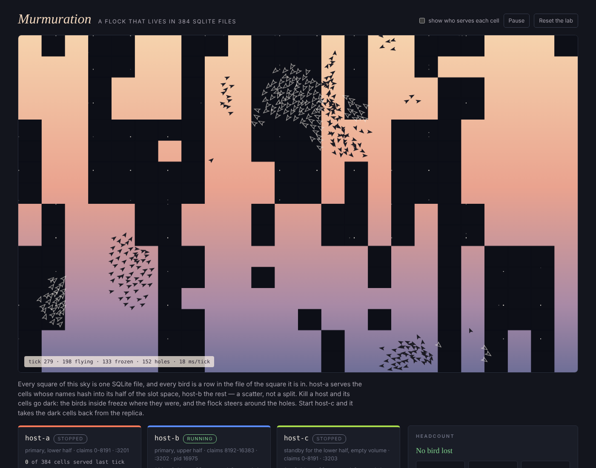

# Murmuration

A flock of boids whose only home is a SQLite fleet split between hosts.
Kill a host and holes open in the sky; start the standby and it closes them
from the replica. Built on autumn-web 0.9's tenant fleet with
`[database.fleet.ownership]` and `[replication]`. See `PITCH.md` for what it
shows and `docs/FINDINGS.md` for what it found.



## Run it

```sh
cargo run --release      # the console on http://localhost:3000
```

A debug build works too; the flock just ticks slower (about 120 ms a tick
against 20–80 ms). The console makes `./murmuration-lab/`, writes each host's
`autumn.toml` from `crates/murmuration-app/host.toml`, starts host-a
(`:3201`, slots 0–8191) and host-b (`:3202`, slots 8192–16383), and releases
60 birds once both serve every cell. Births take the flock to 400. host-c
(`:3203`) is a standby for 0–8191 with an empty volume. Ctrl-C stops every
host.

```
murmuration-lab/
  shared/control.db     the ownership table, shared by every host
  shared/replica/       the replication destination, shared
  host-a/volume/        host-a's fleet root: one file per cell it serves
  host-a/host.log       its log
  …
```

| Control | What it does |
|---|---|
| kill -9 | SIGKILL. Its cells are holes until another host claims them. |
| Stop cleanly | SIGTERM: ships, releases its ranges, exits. |
| Freeze / Thaw | SIGSTOP / SIGCONT: a host that still believes it owns its cells. |
| show who serves each cell | Tints each cell by the host that answered for it last tick. |
| Pause / Fly | Stop or start the conductor. |
| Reset the lab | Stop everything, delete `murmuration-lab/`, start again. |

The headcount separates birds **frozen** in holes (unknown until the hole
closes), birds that **came back older** (their cell was restored from a
replica that was behind), **ghost** copies (a bird in two cells after a move's
delete failed or was rewound; the older copy is deleted), and birds **lost**:
in no cell, with no holes left in the sky.

## Layout

- `crates/sky` — pure: the 24 × 16 torus of cells, the flock, moving a bird
  between cells (insert, then delete), resolving copies, the headcount, the
  per-cell epoch watermark. Property-tested; three Verus models.
- `crates/murmuration-app` — `murmuration-app host` (a tenant fleet, one
  tenant per cell, `POST /api/cells/read` and `/api/cells/write` in batches)
  and `murmuration-app` (the console: supervisor, conductor, sky).
- `crates/murmuration-app/tests/sky.rs` — the lab's claims against three real
  host processes.
- `tools/drill.py` — the same claims through the console, stdlib only.
- `verus/src/` — `geom.rs` (cells and the torus), `moves.rs` (a move never
  drops a bird), `resolve.rs` (the newest copy wins).

## Verify

```sh
./verify.sh            # fmt, clippy, tests, console + drill, routes audit, Verus
./verify.sh --quick    # without the console and the drill
```

`verify.sh` on the Mac is the authoritative gate, and the only one that runs
Verus; the cloud build does not. `docs/SPEC.md` section 8 records what each
model proves.
