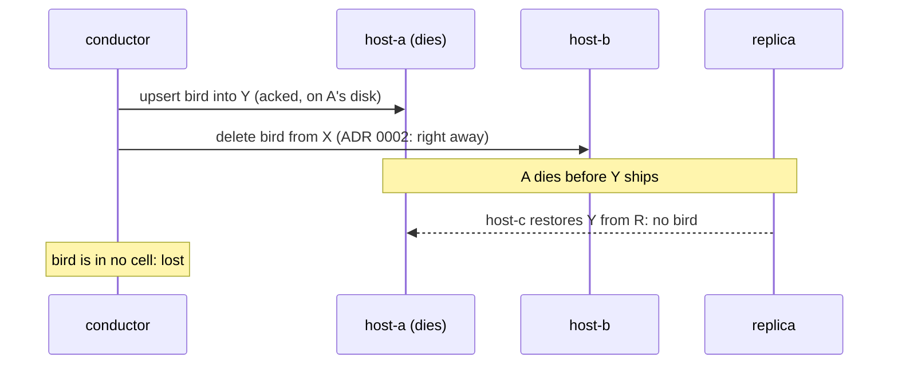

# ADR 0003: Delete a bird's older copy only once a newer one is in a replica

Status: accepted, 2026-11-07. Amends ADR 0002's phase 2.

## Context

ADR 0002 deleted a bird from the cell it left as soon as the destination
acknowledged the upsert. An acknowledgement means the write committed on the
destination host's disk. A takeover restores the cell from the replica, which
is up to `worst_lag_seconds` behind. A bird whose upsert into a dead host's
cell had not shipped was then in no cell: the source copy was already gone.
On autumn-web 0.10 that cost 35–42 birds per takeover, at 400 birds
(FINDINGS 5).

## Decision

- A delete of a bird's rows older than `below` is sent only if a row of that
  bird at `below` or newer is known to be in a replica. There is no phase 2:
  the row a move leaves behind is an older copy, which resolution finds on the
  next read and the guard lets go once the new row ships.
- Each cell write answers with the time it committed on the host's clock.
  Each read answers with a bound on that clock, by which every committed write
  is replicated. The conductor confirms a write when it committed by the bound
  and the host still serves the cell at the same epoch (the same file).
- A bird new to the conductor (released, born, found) is an egg until a row of
  it is confirmed replicated. Only then does it count in the population. An egg
  whose cell comes back without it is *unhatched*, not lost.
- The bound comes from autumn-web 0.10's `replication:fleet` health:
  `now - (worst_lag_seconds + 1) s - 1 s`, and none while a database is
  closing, unowned, or none is open. autumn-web has no per-database "replica
  current through" today; FINDINGS 7 proposes one
  (autumn-foundation/autumn#3658), and the host switches to it
  when it ships.

`verus/src/moves.rs` models the live cells, the replica, ships and restores,
and proves that a bird with a row in a replica always has a row in a live
cell (`theorem_moves_never_drop`). `crates/sky/src/durable.rs` runs the same
protocol against random ships, reports and restores in a property test.

## Consequences

- Zero birds lost in the drill: three runs, takeover and fail-back, at 400
  birds (FINDINGS, Status).
- A bird that crossed into a dead host's cell after its last ship now comes
  back from its older copy instead of vanishing. More birds "come back older"
  (166–172 per takeover, against 106–155), and by more: up to the delete wait,
  about 3 s, instead of about 1 s.
- Each moving bird is in two cells for about 3 s; about 800 rows are held at
  400 birds. A tick is one write round trip instead of two, and no slower.
- The health-derived bound is conservative but rests on one timing assumption:
  a replication tick's checkpoint and retention sweep take under a second.
  The per-database API removes it.
